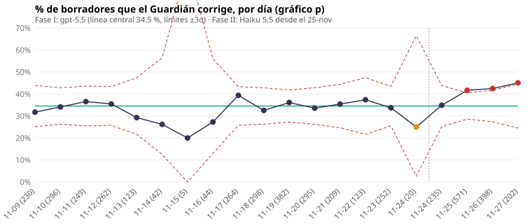

# Haiku 5.5 en las piezas que no son el vendedor (27-nov-2026)

> Pedido: ver qué piezas del bot que NO son el vendedor conviene pasar a Claude Haiku 5.5
> (o afinar), medido. Producción no se tocó: base en solo lectura, nada en Railway.
> Todo lo que se corrió está en `app/scripts/haiku-resto/` (cómo repetirlo, al final).

## Qué estás viendo

Cuatro piezas, cada una con lo mismo: cuánto cuesta hoy al mes, cuánto costaría con el
cambio, qué tan bien lo hace (con ±σ) y qué hacer. Los jueces de calidad fueron
**subagentes de Claude Code que no veían qué modelo había contestado** (o comparación
exacta, en las fotos). Costos al mes = volumen real del 25 al 27-nov (Black Friday)
llevado a 30 días.

| Pieza | Hoy | Costo/mes hoy | Propuesta | Costo/mes propuesto | Calidad hoy → propuesta | Veredicto |
|---|---|---|---|---|---|---|
| **Visión** (fotos de la llanta) | gpt-5.5 | $4,61 | Haiku 5.5 + regla «no escribas una medida dudosa» | **$0,14** | medidas equivocadas o inventadas **8 → 0** de 61 fotos; sin leer 0 → 5 (el bot pide la medida por escrito) | **Cambiar** (PR) |
| **Clasificador** de etapa | gpt-5.4-mini | $2,50 | Haiku 5.5 | **$1,00** | aciertos **90 % ±4 → 96 % ±3** (50 reales) | **Cambiar** (solo variable) |
| **Guardián** | Haiku 5.5, esfuerzo `low` | $13,58 | Haiku 5.5, esfuerzo **`medium`** | $17,90 (+$4,30) | corrige lo que estaba bien **51 % ±9 → 26 % ±8**; +3 s por mensaje | **Cambiar** (solo variable) |
| **Rutina** (`cotizacion_enviada` / `seguimiento_venta`) | gpt-5.4-mini | $5,14 | Haiku 5.5 | ~$4,70 (contando que a veces escala a Sonnet) | puntaje 16 → 14 de 30, ±3 (empate) | **No cambiar** |

Plata en juego: estas cuatro piezas son **~$26/mes de ~$185/mes** de IA de Depot (el vendedor
Sonnet es el resto). El ahorro total posible acá es de unos pocos dólares; **lo que más vale
de este informe es la calidad**: el Guardián Haiku corrige de más y la visión gpt-5.5 lee
mal 1 de cada 9 medidas.

---

## 1. Guardián (Haiku 5.5)

### ¿Por qué solo la mitad de la entrada viene del caché?

Medido en producción (1.190 llamadas desde el 25-nov) y con `count_tokens` sobre 60
contextos reales rearmados:

| Parte de cada llamada | Tokens | Cómo se cobra |
|---|---|---|
| Rúbrica (`INSTRUCCIONES`, el `system`) | 7.994 | caché ($0,01/M) — es el «8 K leídos» |
| Contexto de la conversación (hechos, catálogo del día, conversación, borrador) | 6.178 de media (4,3 K–8,1 K) | **sin caché** ($0,10/M) |
| Esquema de salida y envoltura | ~800 | sin caché |
| Escritura de caché | 807 de media por llamada | ~10 % de las llamadas encuentran el caché vencido (5 min sin tráfico) |

**La mitad sin caché es el contexto de cada conversación, y es lo correcto**: cambia en cada
llamada. Dentro de él hay **2.641 tokens que son iguales en todas** (formas de pago, promo
Black Friday, beneficios, horarios, locales, regla de equivalencias, origen de marcas; +739 en
los seguimientos), mezclados entre los hechos. Moverlos al prefijo cacheado (variante «fijo»)
**baja el costo 9 %** ($0,00097 → $0,00088 por llamada, ~$1,20/mes) pero **cambió cómo juzga**
el Guardián: marcó severidad ALTA en 50 % de los borradores contra 34 %. Por $1,20 al mes no
vale el riesgo. Tampoco vale el caché de 1 hora: las reescrituras cuestan ~$1,20/mes.

Dónde se va la plata de una llamada: **64 % entrada sin caché, 27 % salida** (razonamiento +
JSON), 9 % caché. Cuesta $0,00097 por revisión (gpt-5.5 costaba ~$0,02).

### ¿Qué tan bien frena?



**Qué estás viendo:** % de borradores corregidos por día. Fase I = Guardián gpt-5.5 del 9 al
24-nov (línea central 34,5 %, límites ±3σ en rojo). Fase II = Haiku desde el 25-nov: **los
tres días están fuera del límite de arriba (41,7 %, 42,5 %, 45,0 %) → señal**: Haiku corrige
más. Ojo: el mismo día entró el vendedor Sonnet, así que el gráfico solo no dice si los
borradores empeoraron o el Guardián exagera. Eso lo responde la prueba de abajo.

**La prueba:** 40 revisiones reales de Haiku en producción (20 que aprobó, 20 que corrigió,
conversaciones distintas), con el contexto rearmado al instante de la revisión. Dos jueces a
ciegas (subagentes, con la rúbrica) dijeron cuáles borradores de verdad había que corregir:
**11 de 40 (7 graves)**. Después se corrió el Guardián otra vez sobre los mismos 40, en
cuatro variantes, 2 o 3 repeticiones cada una.

| Variante | Corrige lo que estaba bien (FP)* | Deja pasar lo que había que corregir (FN) | Deja pasar graves | $/llamada | Salida | Latencia p50 / p95 |
|---|---|---|---|---|---|---|
| Producción, tal como corrió (1 vez) | 48 % (14/29) | 45 % (5/11) | 43 % (3/7) | — | — | — |
| **`low` (lo de hoy)** ×3 | **51 % ±2** (binomial ±9) | 33 % ±5 | 14 % ±14 | $0,00097 | 560 tk | 2,2 s / 6,6 s |
| **`medium`** ×2 | **26 % ±2** (binomial ±8) | 32 % ±6 | 7 % ±10 | $0,00128 | 1.175 tk | 5,1 s / 10,8 s |
| sin razonar (`thinking: disabled`) ×3 | 68 % ±2 | 18 % ±0 | 29 % ±0 | $0,00086 | 335 tk | 2,3 s / — |
| hechos fijos al caché ×2 | 50 % ±7 | 23 % ±6 | 7 % ±10 | $0,00088 | 731 tk | 3,1 s / — |

\* Sin contar los hallazgos de `stock_prometido`: el catálogo rearmado es el de hoy, no el del
momento, y esos hallazgos no se pueden juzgar. «±» = desvío entre repeticiones; «binomial» =
el error por tener solo 29 borradores sanos.

Lo que dice:

- **Haiku `low` corrige la mitad de los borradores que estaban bien.** Llevado a la mezcla real
  de producción: de cada 10 correcciones del Guardián, **solo 3 eran necesarias**, y deja pasar
  la mitad de las que sí. Las falsas más comunes: `re-pregunta` (dice que el bot repregunta lo
  ya respondido cuando no), `contradiccion`, `insiste_tras_rechazo`. Cada corrección falsa
  reescribe un mensaje bueno y, si es ALTA, le abre una alerta al asesor.
- **`medium` corta los falsos positivos a la mitad (51 % → 26 %)** sin dejar pasar más
  (FN 33 % → 32 %, graves 14 % → 7 %). La diferencia es ~2,8σ con la muestra chica, y es
  pareada (mismos 40 borradores), así que es real.
- **Costo de `medium`: +32 % ($13,58 → ~$17,90/mes) y +3 s de espera por mensaje** (p95
  10,8 s; el tope del Guardián es 20 s, ninguna pasó de 14,8 s).
- Apagar el razonamiento ahorra 11 % pero corrige todavía más de lo debido: no.

**Recomendación:** poner `AI_CLAUDE_EFFORT_GUARDIAN=medium` en el servicio de Depot (es solo
la variable; el código ya la lee). Después, mirar el gráfico p unos días: el % corregido
debería volver cerca del 34 % de gpt-5.5.

Límites de esta prueba: 40 casos (11 con error real), el contexto rearmado no trae la huella de
herramientas del turno ni el stock del momento, y la ficha es la de hoy. Por eso el Guardián
corrige más acá (60 %) que en producción (42 %); la comparación entre variantes es justa porque
todas ven lo mismo.

---

## 2. Rutina (`OPENAI_ROUTINE_MODEL`)

15 turnos **reales** de producción que atendió gpt-5.4-mini en etapa rutinaria. Cada uno se
repitió en el simulador **dos veces** (una con mini, otra con Haiku), arrancando con la
conversación real cortada justo antes del turno (`--copiar-conv --hasta`) y mandando lo que el
cliente escribió de verdad. Todo lo demás como producción hoy: vendedor Sonnet 5.5, Guardián
Haiku 5.5. Un subagente juzgó los pares a ciegas (A/B al azar), 0–2 puntos cada respuesta.

| | gpt-5.4-mini (hoy) | Haiku 5.5 |
|---|---|---|
| Puntos (de 30) | **16** | **14** |
| Turnos ganados / empates | 4 / 7 | 4 / 7 |
| Respuestas malas (0 puntos) | 5 | 7 |
| Diferencia media por turno | | −0,13 ±0,22 → **empate** |
| $ por turno, solo la rutina | $0,0034 | $0,0007 |
| $ por turno, contando lo que escaló | $0,0040 | $0,0036 (1 de 15 se fue a Sonnet: $0,044) |
| Herramientas | cotizó al que pidió descuento, avisó al asesor (provincia) | no llamó ninguna de las dos |

Producción: 1.193 turnos de rutina al mes, **$5,14/mes**. Haiku ahorra en cada llamada, pero
cuando no resuelve en dos rondas el turno pasa al vendedor Sonnet y eso se come el ahorro.
Calidad empatada, con Haiku un poco más flojo en lo concreto («Carísimas» → no dio la opción
más barata; «quiero ir a ver las llantas» → solo repitió «¿la 1, la 2 o la 3?») y mejor para
despedirse. **Recomendación: dejar gpt-5.4-mini.** No hay ahorro que justifique el riesgo.

**Fallas que tienen LAS DOS** (y por eso no son del modelo — familia para la próxima auditoría):
- A quien ya eligió local y se despide, se le vuelve a preguntar «¿Cumbayá o Quito Sur?»
  (52619, 54214): parece un cierre pegado después del modelo.
- Al cliente de provincia (53252) ninguna le dice que un asesor lo contacta.
- Pidió el precio de las 4 con la promo y no se le dio (53126).
- «No» a «¿alguna otra duda?» se leyó como cambio o cancelación de la visita (54032).

---

## 3. Clasificador de etapa

50 clasificaciones reales de producción (desde el 25-nov), rearmadas con el mismo prompt de
`agent/classifier.ts` (etapa del momento, lo que escribió el cliente, lo que contestó el bot) y
corridas con gpt-5.4-mini y con Haiku 5.5. Coincidieron en 42; los 8 desacuerdos los juzgó un
subagente a ciegas.

| | gpt-5.4-mini (hoy) | Haiku 5.5 |
|---|---|---|
| Aciertos (de 50) | **45 (90 % ±4)** | **48 (96 % ±3)** |
| Desacuerdos ganados | 2 (+1 empate) | 5 (+1 empate) |
| $ por llamada | $0,00042 | **$0,00017** |
| Costo/mes (6.480 llamadas) | $2,50 | **~$1,00** |
| Latencia mediana | 0,7 s | 1,1 s (corre después del turno: no se nota) |

Errores de mini que Haiku no hace: «Ok gracias» → `cotizacion_enviada`; «Muy amable, alto el
precio» → se queda en `nuevo`; «Si» a las opciones → `seleccionando` sin evidencia. Igual, los
candados de abajo (`cotizacion_enviada` exige cotización, el funnel no retrocede) ya frenaban
varios.

**Recomendación:** `OPENAI_CLASSIFIER_MODEL=claude-haiku-5-5` (solo variable). Ahorro chico
($1,50/mes), calidad igual o mejor. Si Anthropic falla, entra el respaldo de OpenAI de
`chat.ts`. Detalle menor: el clasificador registra en `ai_runs` el modelo pedido aunque haya
contestado el respaldo.

---

## 4. Visión (fotos del costado)

Las **63 fotos reales** que mandaron clientes desde el 23-nov (guardadas en `message_media`;
no salieron de la Mac salvo a la API). Un subagente las leyó una por una a ciegas y anotó la
verdad: 35 con medida legible, 26 sin medida (afiches, solo DOT, rueda de lejos, borrosas). Se
excluyeron 2 (una captura de cotización y un duplicado). Se puntúa con **el mismo extractor
del bot** (`extractTireSizes`), porque eso es lo que el bot termina usando.

| Modelo | Medida exacta (de 35) | **Medida equivocada** | Sin leer (pide por escrito) | **Inventa en foto sin medida** (de 26) | $/foto | Costo/mes (462 fotos) |
|---|---|---|---|---|---|---|
| gpt-5.5 (hoy, lo que leyó en producción) | 31 (89 % ±5) | **4** | 0 | **4** | ~$0,0100 | $4,61 |
| Haiku 5.5 `low`, prompt de hoy | 33 | 2 | 0 | 4 | $0,00024 | $0,11 |
| Haiku 5.5 `medium`, prompt de hoy | 34 | 1 | 0 | 2 | $0,00031 | $0,14 |
| Sonnet 5.5 `low`, prompt de hoy | 34 | 1 | 0 | 3 | $0,0047 | $2,17 |
| **Haiku 5.5 `low` + regla nueva** | 30 (86 % ±6) | **0** | 5 | **0** | $0,00030 | **$0,14** |
| Haiku 5.5 `medium` + regla nueva | 31 | 0 | 4 | 0 | $0,00036 | $0,17 |

Los errores de gpt-5.5 hoy: 245/65R17 leída 225/65R17; 215/75R14 leída 265/70R16; LT215/75R15
leída 175R15C; 235/60R16 leída 265/70R16; y en fotos sin medida completa escribió 175/70R13,
215R16LT y 215/40ZR17 (dígitos tapados). Cada una de esas es una cotización de otra llanta.

Claude lee mejor, pero **escribe con dudas** («medida probable 215/70R16», «posible
265/70R16») y convirtió «33x12.50R20» a «265/50R20»: el extractor toma eso como la medida del
cliente. La **regla nueva** («escribe una medida SOLO si se lee completa y sin dudas; nada de
probable; las pulgadas sin convertir») lo corta: **0 medidas equivocadas y 0 inventadas**. A
cambio, 5 de 35 quedan sin leer y el bot le pide al cliente que la escriba: es el fallo barato.
Además es el doble de rápido (1,2 s contra 2,6 s).

**Recomendación:** el PR agrega la regla **solo cuando el modelo de visión es Claude** (con
gpt-5.5 no se midió y no cambia nada). Con el PR en `main`, poner
`OPENAI_VISION_MODEL=claude-haiku-5-5`. Ahorra ~$4,50/mes y, sobre todo, deja de cotizar
medidas mal leídas.

---

## Lo que se gastó

| | |
|---|---|
| API de Anthropic (clave de pruebas = la de producción) | **$1,22** de $4 (Guardián $0,76 · visión $0,37 · rutina $0,08 · clasificador $0,01; `count_tokens` es gratis) |
| API de OpenAI (clasificador mini y simulador de la rutina) | ~$0,12 |

## Cómo repetirlo

Todo en `app/scripts/haiku-resto/` (lee la base de producción forzada a solo lectura; los
datos con chats quedan en `datos/`, que no se versiona):

```bash
node scripts/haiku-resto/contextos-guardian.mjs 60            # qué parte del contexto se repite (count_tokens, gratis)
node scripts/haiku-resto/casos-guardian.mjs casos.json 20      # 20+20 revisiones reales con su contexto
node scripts/haiku-resto/limpiar-casos.mjs casos.json          # saca lo que el bot mandó después
node scripts/haiku-resto/correr-guardian.mjs casos-limpio.json medium 2 medium.json
node scripts/haiku-resto/fp-fn-guardian.mjs casos-limpio.json juezA.json juezB.json low.json medium.json
node scripts/haiku-resto/grafico-guardian.mjs guardian.svg
node scripts/haiku-resto/clasificador.mjs <dir> 50
node scripts/haiku-resto/exportar-fotos.mjs <dir>/fotos && node scripts/haiku-resto/vision.mjs <dir>/fotos claude-haiku-5-5 low
node scripts/haiku-resto/puntuar-vision.mjs <dir> <dir>/vision-*.json
node scripts/haiku-resto/casos-rutina.mjs rutina.json 15 && node scripts/haiku-resto/rutina.mjs rutina.json claude-haiku-5-5 0 salida.json
```

El simulador ganó la bandera `--routine-model M` para forzar el modelo de las etapas rutinarias.
